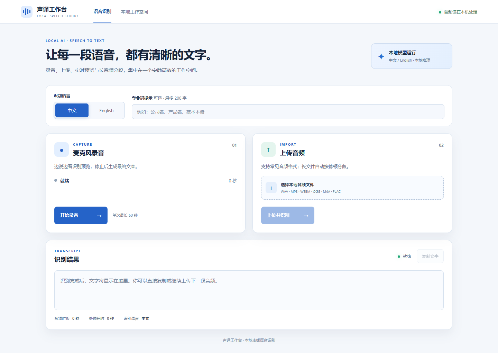
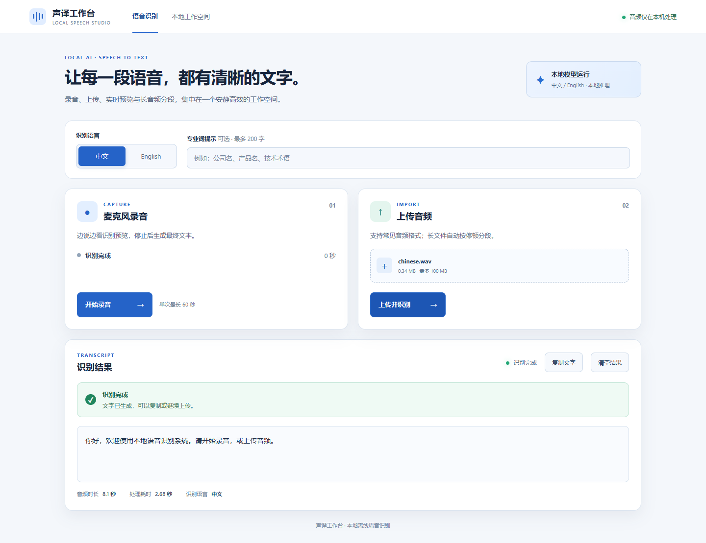
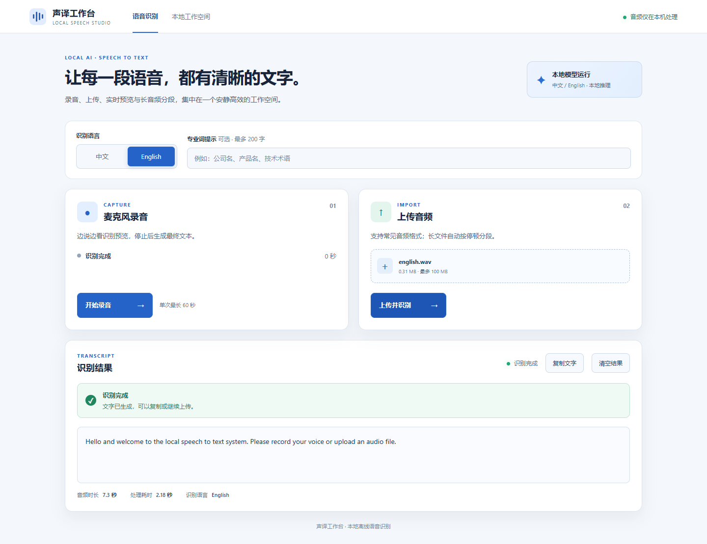
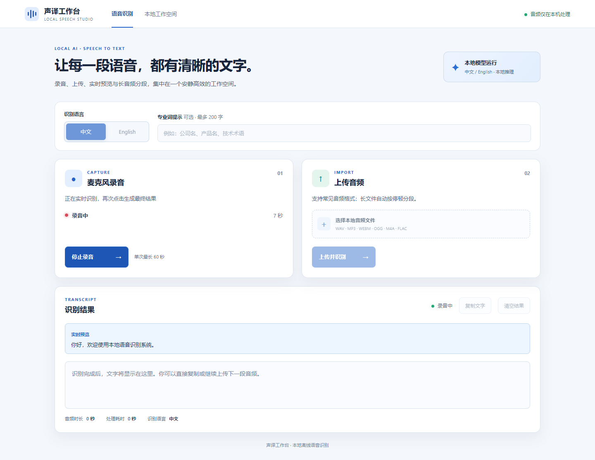
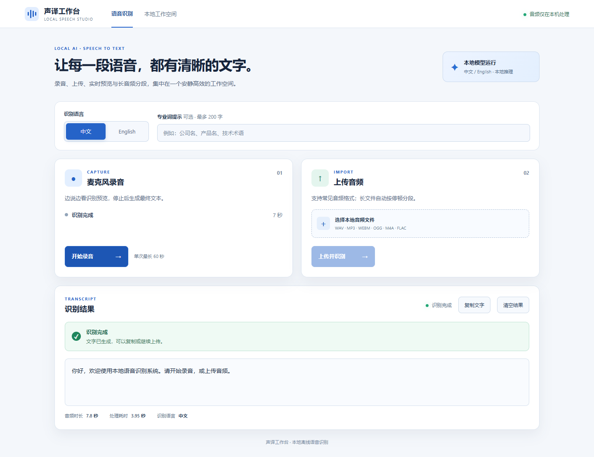

# 声译工作台 · 本地中英文语音识别

基于 Python 3.12、FastAPI 和 faster-whisper small 的本地语音识别系统。支持浏览器麦克风录音、音频上传、中文与英文识别，以及录音过程中的实时预览。模型使用 CPU INT8 推理，音频只提交到本地后端。

## 效果预览

| 系统首页 | 中文音频识别 |
| --- | --- |
|  |  |

| 英文音频识别 | 录音实时预览 |
| --- | --- |
|  |  |



## 环境与安装

- Windows 11 x64，Python 3.12，最新稳定版 Chrome 或 Edge。
- 建议 8 GB 内存；不需要 Node.js、GPU、Docker、数据库或云端 ASR。
- 首次模型初始化需要联网下载约 484 MB 权重；缓存完成后可离线运行。

在项目根目录执行：

```powershell
python -m pip install -r requirements.txt
python -m uvicorn app.main:app --host 127.0.0.1 --port 8000
```

打开 http://127.0.0.1:8000/ 。`/health` 在模型就绪时返回 `{"status":"ok"}`。

模型默认使用 `small`、`cpu`、`int8` 和 4 个 CPU 线程，缓存于 `~/.cache/huggingface/hub`。资源有限时可设置 `ASR_MODEL_SIZE=base`；也可将 `ASR_MODEL_SIZE` 指向本地模型目录。模型准备完成后离线启动：

```powershell
$env:HF_HUB_OFFLINE = "1"
python -m uvicorn app.main:app --host 127.0.0.1 --port 8000
```

## 功能使用

- **录音**：点击「开始录音」并授权，支持手动停止、60 秒自动停止和再次录音。
- **实时预览**：AudioWorklet 每约 4 秒生成 PCM WAV 分片，通过 HTTP 提交本地模型；页面在录音期间持续追加预览，停止后提交完整录音生成最终稿。
- **上传**：选择或拖入 WAV、MP3、WebM、OGG、M4A、FLAC，录音和上传共用后端识别接口。
- **结果**：展示识别语言、状态、文本、音频时长和处理耗时，支持复制。
- **异常**：处理权限拒绝、无设备、空文件、不支持格式、无法解码、无语音、超时和模型错误，页面可恢复重试。

数字静音在推理前返回空文本。实时延迟为约 4 秒采集加 CPU 推理时间，不属于商业级实时字幕。

## 接口

| Method | Endpoint | 说明 |
| --- | --- | --- |
| GET | `/` | Web 工作台 |
| GET | `/health` | 服务健康检查 |
| POST | `/api/transcribe` | multipart 上传音频并识别 |

识别接口必须字段为 `file` 和 `language=zh|en`，可选 `context`、`preview`、`recording`。成功响应包含 `text`、`language`、`duration_seconds`、`processing_seconds`。非法输入返回 4xx，模型不可用或推理失败返回 5xx。

```powershell
curl.exe -X POST http://127.0.0.1:8000/api/transcribe -F "file=@samples/chinese.wav" -F "language=zh"
curl.exe -X POST http://127.0.0.1:8000/api/transcribe -F "file=@samples/english.wav" -F "language=en"
```

## 测试

常规自动化测试：

```powershell
python -m pytest -q
```

该命令使用模型替身，不依赖真实麦克风，也不会因缺少模型缓存而下载权重。测试样本和参考文本位于 `samples/`。

真实本地模型浏览器验收需要另开一个终端按上面的命令启动服务，再执行：

```powershell
python -m pip install "playwright>=1.49,<2"
python -X utf8 -m tests.verify_browser --record-limit --output docs/evidence/browser-real.json
```

测试使用本机 Chrome 和真实本地模型，以仓库样本模拟麦克风输入，验证中英文上传、停止前连续预览、停止后终稿、权限拒绝、预览失败恢复和 60 秒自动停止。可设置 `HF_HUB_OFFLINE=1` 验证缓存后的离线识别；`ASR_TEST_PORT` 可指定其他服务端口。

## 目录结构

```text
local-speech-to-text/
├── app/                 # FastAPI、音频解码与本地模型集成
├── static/              # HTML/CSS/JavaScript、录音与实时预览模块
├── tests/               # pytest 与真实模型浏览器验收
├── samples/             # 中英文 WAV 和人工参考文本
├── docs/
│   ├── requirements.md
│   ├── design.md
│   ├── test-report.md
│   ├── screenshots/     # 运行效果截图
│   └── evidence/        # 自动化测试与真实模型验收结果
├── requirements.txt
├── pytest.ini
├── README.md
└── .gitignore
```

模型权重、虚拟环境和依赖二进制不放入源码仓库。前端静态资源已随仓库提供，模板 MIT 许可见 `static/LICENSE`。
